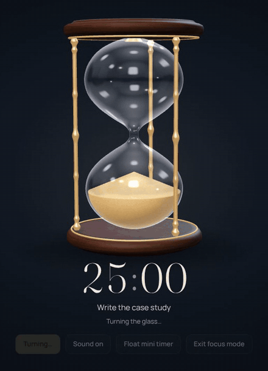
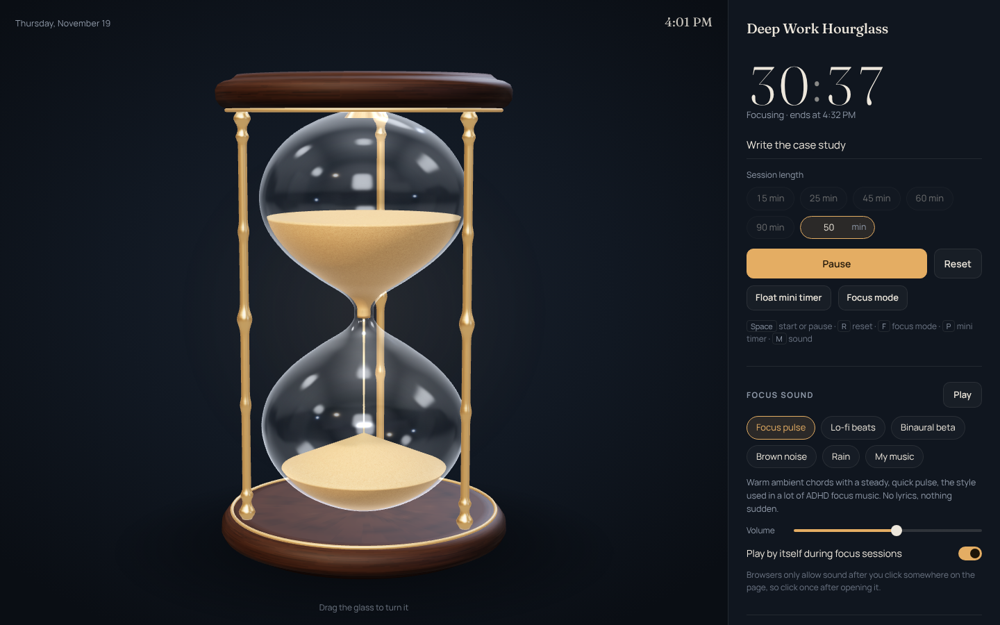
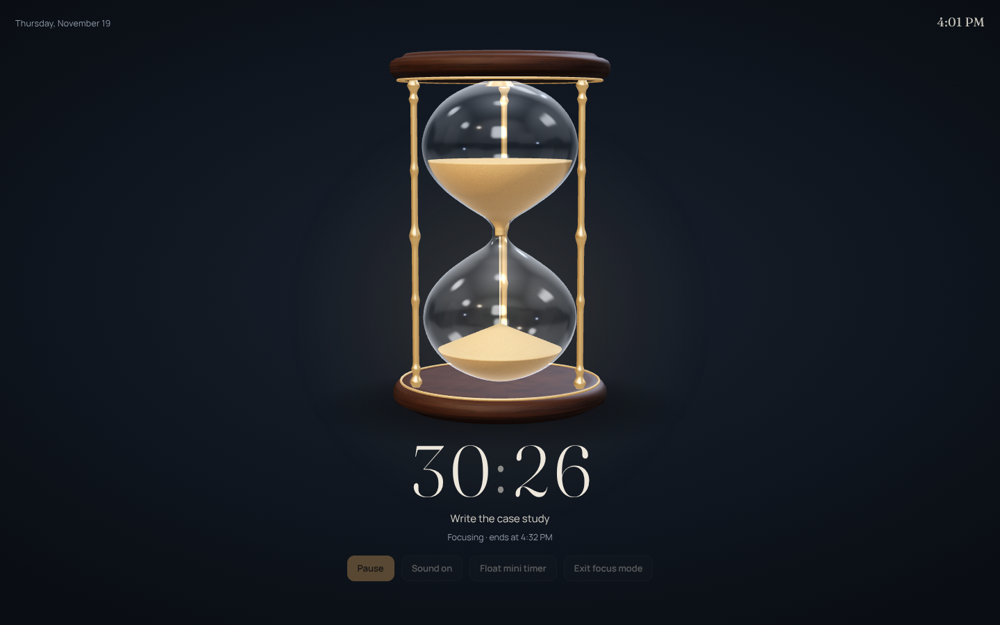
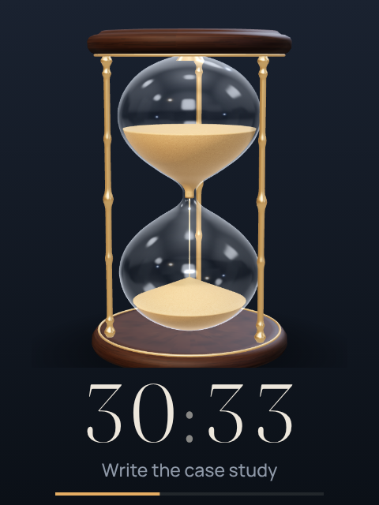

  

<h1 align="center">Deep Work Hourglass</h1>

  A 3D sand timer for deep work, with ADHD-friendly focus music, a schedule, 
  and a mini timer that floats over every window. 
  <b>Free · no sign-up · works offline · nothing leaves your browser</b>

  <a href="https://jthakur93.github.io/deep-work-hourglass/"><b>▶ Open the app</b></a>

## Why an hourglass

A digital countdown keeps asking you to read it. Sand doesn't. You can see how much time is left from the corner of your eye, and the slow fall is calming rather than stressful. This app puts a real-looking hourglass on your screen and adds the things that help you start and stay in deep work: music that blocks out distraction, a schedule that starts sessions for you, and a small timer that stays visible while you work in other apps.

## What it does

- **A hourglass that looks real.** Glass, brass and walnut, rendered in 3D. It turns over when you press Start, and the sand falls in real time. Drag it to spin it.
- **Any session length.** 15, 25, 45, 60 or 90 minutes, or type your own (up to 4 hours). Pause, resume or reset at any time.
- **Focus music built in.** Six sounds, all generated live in the browser:
  - **Focus pulse:** warm chords with a steady, quick pulse, the style used in a lot of ADHD focus music
  - **Lo-fi beats:** mellow chords over a slow, soft beat, never the same loop twice
  - **Binaural beta:** a 16 Hz binaural beat (use headphones)
  - **Brown noise** and **Rain**
  - **My music:** your own audio files, played as a repeating playlist

  The sound starts with your session and fades out just before the bell.
- **Or bring your own music.** Build your own playlist from YouTube videos and playlists (or play a live stream such as Lofi Girl), or from Spotify playlists, albums and tracks. Log in to Spotify in the same browser and full songs play from your account. Choose what happens when a track ends: repeat it, play the next one, or shuffle, so the music lasts your whole session. Your playlist is saved for next time.
- **A floating hourglass.** One click pops out just the hourglass, on top of every app, even when the main window is minimised. Drag it anywhere and resize it; hover over it for the time, pause and sound. On phones it floats over your other apps too (Chrome on Android, Safari on iPhone).
- **A focus schedule.** Add blocks such as *9:30 AM, 90 min, weekdays*. When a block starts, the glass turns over by itself. One click adds the block to Google Calendar, so you get reminded even when the app is closed.
- **Focus mode.** Full screen, with only the glass and the time.
- **Your progress.** Sessions finished today and minutes focused over the last 7 days.
- **Installs like an app** on desktop and phone, and keeps working offline after your first visit.

| Focus mode | Floating mini timer |
|---|---|
|  |  |

## Keyboard shortcuts

| Key | What it does |
|---|---|
| <kbd>Space</kbd> | Start or pause |
| <kbd>R</kbd> | Reset |
| <kbd>F</kbd> | Focus mode |
| <kbd>P</kbd> | Float the mini timer |
| <kbd>M</kbd> | Sound on or off |

## Install it as an app

Open **[the app](https://jthakur93.github.io/deep-work-hourglass/)**, then:

- **Chrome or Edge (Windows, Mac, Linux):** click the install icon at the right end of the address bar, or open the menu → *Cast, save and share* → *Install page as app*.
- **Safari on Mac:** *File* → *Add to Dock*.
- **iPhone or iPad:** *Share* → *Add to Home Screen*.
- **Android:** menu ⋮ → *Install app*.

## Privacy

There are no accounts, no tracking and no server. Your schedule, focus history and settings are kept in your own browser's storage, and so are any music files you add. They never leave your device.

The app loads its two fonts from Google Fonts. YouTube and Spotify only connect when you pick them: your browser then talks to that service directly, under its own terms and privacy policy, and they may set their own cookies. The app never sees your YouTube or Spotify account. The sounds under "Made here" need no connection at all.

## Browser support

It's built for current Chrome, Edge and Safari, on desktop and mobile. Firefox runs the timer, the 3D glass and the music, but it doesn't let web pages open the floating mini timer. If something doesn't work in your browser, please [open an issue](https://github.com/jthakur93/deep-work-hourglass/issues).

Browsers only play sound after you've tapped or clicked the page once, so tap anywhere after opening it. On an iPhone the generated sounds play even with the ring switch on silent (iOS 17 or later). On phone speakers, Lo-fi and Rain come through best; the deeper sounds need headphones.

Spotify plays full songs only when you're logged in to Spotify in the same browser; otherwise it plays 30-second previews. YouTube may show ads, and on phones YouTube stops when the screen locks. YouTube and Spotify need the online app, so they don't play in a downloaded copy.

On a computer, the floating hourglass uses a small always-on-top window (Chrome and Edge). Browsers always draw a thin frame around it; a completely frameless desktop widget would need a separate desktop app.

## Run it yourself

The whole app is a single file, `index.html`, with three.js bundled inside. You can open it straight from your computer, or host the folder anywhere.

To change it:

1. Edit `src/index.html`. This is the readable source, and it loads three.js from a CDN, so you can open it directly while you work.
2. Run `npm install`, then `npm run build`. This bundles everything back into `index.html`.

Pull requests and ideas are welcome. Please [open an issue](https://github.com/jthakur93/deep-work-hourglass/issues) first for anything big.

## Credits

Made by [Jyoti Thakur](https://github.com/jthakur93). Built with [three.js](https://threejs.org) and the Web Audio API. Fonts: Fraunces and Manrope.

YouTube and Spotify content plays in their official embedded players and belongs to its owners.

## Licence

[MIT](LICENSE). Use it, change it and share it.
